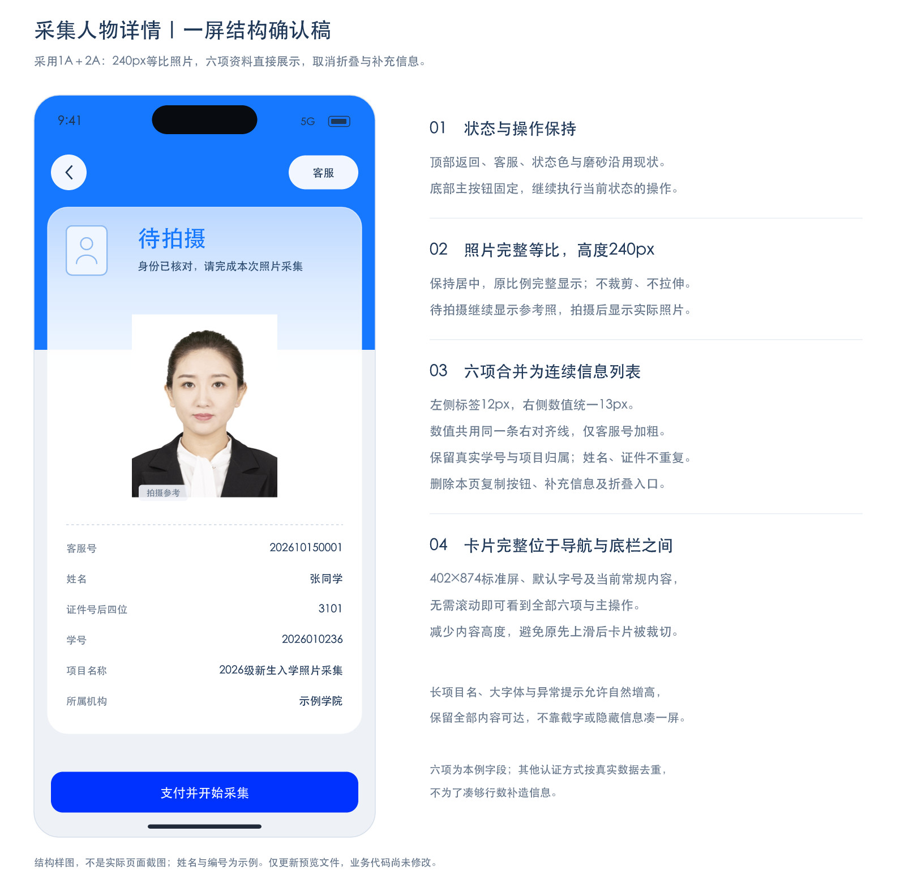

# 采集人物详情｜V1.4.6

日期：2026-10-27。范围：专项采集任务详情及完成状态；本地实现，待用户验收。本仓库仍是React移动Web高保真原型，不代表原生工程、机构接口或正式审核服务已接入。

## 确认依据与页面职责

用户已确认1A＋2A方向及下图：照片完整等比展示至240px，六项信息合为一个连续列表，label在左、value在右；数值统一13px，仅客服号加粗；移除本页复制、补充功能及折叠入口。

该图是设计前已确认的结构稿，不是实现后截图；图中姓名、编号为示例，参考人物不代表该示例采集人。后续变更字段或资料组织时不能把本图当作自动授权。

页面让用户一次核对「采集谁、属于哪个项目、当前状态、下一步操作」。保留既有状态色背景、磨砂主卡、顶部返回／客服及固定底部主动作。上一步来自采集记录、项目或通知，返回继续沿用原来源规则；下一步由当前采集状态决定，不新增付款、认证或审核步骤。

## 资料显示及去重

| 顺序 | 内容 | 来源和规则 |
| --- | --- | --- |
| 1 | 客服号 | `record.customer`，未生成显示「未生成」；仅此value加粗，本页不提供复制按钮 |
| 2 | 姓名 | `record.name`，缺失显示「未提供」 |
| 3 | 证件信息 | id／document／passport方式有`record.number`时直接展示原值，护照号如实命名；否则有`lastFour`时标为「证件号后四位」，不补全号码 |
| 4（适用时） | 学号／工号／认证编号 | student和qr使用「学号」，employee使用「工号」；不与证件末四位混为同一字段。旧记录方式未知但有编号时标为「认证编号」，不推断为身份证号 |
| 5 | 项目名称 | 当前记录对应项目的`name`，不从别的任务取值 |
| 6 | 所属机构 | 对应项目的`organization` |

证件认证去重后可少于六项，不再次显示该证件号的末四位。不为凑够六行生成数据；缺失的已知字段显示「未提供」，已有脱敏值保持脱敏。行值不得截断、反推或通过金额／项目猜测身份资料。

列表与照片共用一个磨砂主卡，照片下方保留原浅色虚线；无新的分组卡片、折叠箭头或重复身份摘要。label12px、value13px为Web默认字号参考；value均右对齐，客服号750字重、其他常规字重，行列间隔12px。三端按既有平台字号、安全区和无障碍规范适配，不将固定Web尺寸冒充所有设备保证。

## 照片与一屏布局

- 参考照和实际成片均使用contain完整等比居中，最大高度240px、最大宽度224px，不裁剪、拉伸或强制改变文件比例。待拍摄保留「拍摄参考」标记，参考照不写入采集记录；实际照片不加该标记。
- 标准402×874逻辑屏、默认字号、常规数据以首屏展示完整卡片及底部主操作为目标。系统区与导航保留现有高度，正文不通过永久空白层或改变卡片z-index掩盖裁切。
- 长项目名、长姓名、大字体、项目限制或异常提示允许自然增高，沿原正文区滚动并保持所有字段可达。底部主操作在滚动区之外，预留自身高度与安全距离，不覆盖最后一行。
- 正常首屏无需为了看到末行而先上滑卡片；不宣称所有设备、字号和异常状态绝对无需滚动。最终手机画面和无障碍适配仍需用户／三端验收。

## 功能移除与兼容边界

移除详情页复制按钮、采集信息抽屉和补充信息功能，包括推荐人／年龄表单、只读补充面板、保存动作及旧面板可达路径。原记录的`record.supplement`保留兼容；拍摄、提交及审核更新记录时不清空这些存量字段，不做破坏性数据迁移。新建任务不再初始化无用途的空补充字段。

客服支持仍有自己的复制能力；`copyCustomer()`继续服务客服支持抽屉，不作为删除整个客服功能的授权。审核未通过／制作失败／上网失败的原因抽屉、提交确认、项目开放限制、本人账号隔离和付费权益保持。

旧采集信息／补充面板不再作为有效面板打开，避免打开无内容的遮罩阻塞详情。普通查看身份资料不触发存储写入。

## 当前实现与验收

实现入口：[`CollectionTaskDetail`](../../src/components/CollectionTaskDetail.jsx)、[`buildCollectionTaskInformation`](../../src/domain/collection-task-information.js)、[详情样式](../../src/styles/collection-task.css)、[任务抽屉](../../src/components/CollectionTaskDrawer.jsx)、[控制器](../../src/domain/collection.js)。状态与主动作继续以[共享状态映射](../../src/domain/collection-status.js)和[专项说明](../collection-zone.md)为准。

源码／状态验收覆盖：资料去重、真实学号与证件后四位区分、护照／证件号、不完整旧记录、长内容不截断、旧补充数据兼容、失效面板不能打开，以及原有认证／扫码／采集／付款／审核／返回链路。实际画面复核与检查结果在交付时单独记录；源码检查不等于用户验收通过。

本轮不自动提交、打标签、推送或部署。后续正式Git交付继续遵守[原型版本规则](../release-versioning.md)。

### 2026-10-27 实施检查记录

- 63项专项状态、示例、项目搜索、扫码及资料规则检查通过；其中涵盖失效面板不可打开、拍摄／提交保留存量补充字段及认证编号不冒充证件号。另对新增未知认证方式边界完成4项资料映射复核。
- 32个实际组件静态渲染组合（8个状态×4种认证数据）及2个已移除面板的空渲染校验通过；既有账号／采集主流程回归组通过。
- 按已有只读授权使用临时隐藏标签查看：待拍摄、制作中、制作失败、待提交审核在402×874逻辑手机中，正文 `clientHeight` 与 `scrollHeight` 均为663px；资料和固定主操作可在首屏查看。照片实测240px，六项value均13px、右边缘一致，仅客服号750字重；失败原因抽屉可正常打开和关闭，详情返回采集记录正常。没有付款、拍摄、提交、导入数据或修改浏览器存储；临时标签已关闭，原页面及4180服务保留。
- 复核发现公共`photo-previews.css`原先将专项成片重设为280px及固定预览比例；已仅解除专项详情的这部分公共覆盖，实际照片由详情样式控制240px与contain，其他业务预览规则保持。
- 生产构建通过；保留既有jsQR静态脚本及大于500KB分块提示。Impeccable对相关组件及样式检查为0项阻断，另有29项色值／字号／圆角登记advisory，不能替代人工视觉验收，也未借本次任务修复设计令牌漂移。
- 以上是固定逻辑手机的只读观察及源码／状态检查，不是浏览器自动UI测试、真实设备或用户验收；小屏、大字体、长内容与原生平台仍需后续验证。未提交或推送Git，未部署站点。
