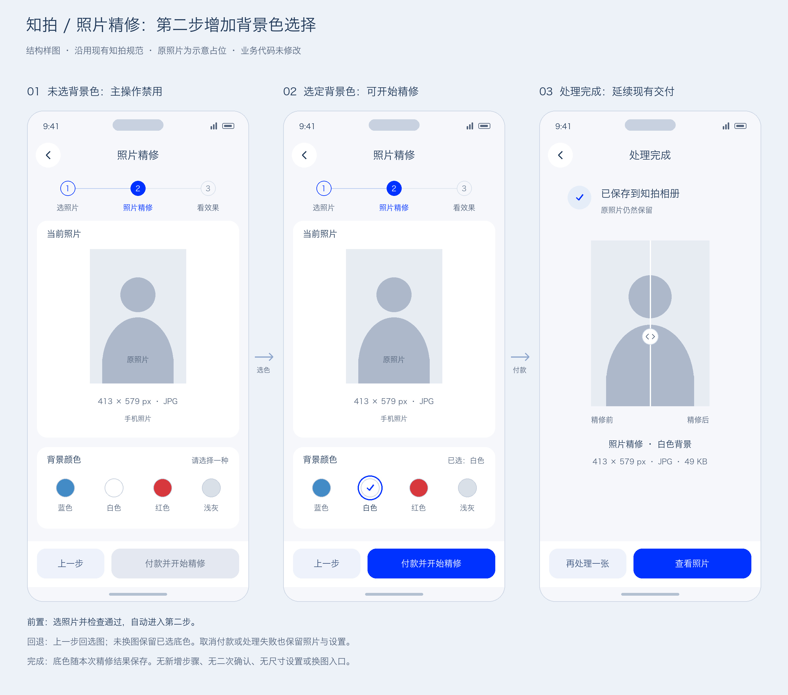

# 照片精修 · 背景色选择结构方案

日期：2026-10-22。状态：用户已明确确认结构样图，以及「保留原图，完成后展示成片」。现已按该结构实现，等待用户验收；以下为本轮设计依据，正式规则同步至产品与设计文档。

## 已确认需求

- 可见的AI精修统一改为照片精修；涵盖步骤和相关付款标题，不改变独立精修的现有收费、检查与交付规则。
- 第二步选背景，蓝色、白色、红色、浅灰四项；默认不预选，必须选择一种才可付款并开始精修。
- 沿用知拍现有设计，用户确认结构图后再实现；本次已明确允许两个独立评审。

## 页面任务与结构

前一步选照片并检查，通过自动进入第二步；不在第二步增加更换照片入口。顶部复用ToolNavigation、ToolStepper，第二步文字为照片精修。主体依次为当前照片及必要文件信息、背景颜色设置。两组使用现有白卡及留白，不增加外层容器或新装饰。

四项均带名称；白色、浅灰保留细边界；选中蓝圈加中央勾，适配单选语义及键盘焦点。组标题右侧未选时为请选择一种、选后回显名称。底部固定上一步与付款并开始精修；未选时主操作禁用，已选且有效、空闲时启用。触控不低于44px，按钮沿用48px、字体和安全区。小屏主体自然滚动，操作区不跟随滚动，不强塞首屏或缩小照片文字。

用户已确认保留原图方案：选色只设置本次精修的目标背景，处理前不伪装已产出，不即时预览底色。

## 已实施前后流程契约

| 状态 | 设置与动作 |
| --- | --- |
| 新照片检查通过 | 第二步四底色均未选，主操作禁用 |
| 选定底色 | 只选一项，主操作启用；不新增二次确认 |
| 上一步，未换照片后继续 | 保留本次底色；换另一张照片则重新检查并清除旧底色及输出 |
| 付款抽屉 | 沿用现有抽屉，显示服务及所选底色、现有¥2.00费用与付款方式 |
| 取消／明确未付款 | 留在第二步，照片、底色保留，可修改 |
| 付款未确认／已付 | 原单底色冻结；先确认原付款事实，不创建另一单或重复收费 |
| 处理中 | 设置及重复操作禁用；沿用照片内处理动效和下方状态 |
| 处理失败 | 保留已付原单、原图、底色；重试执行同一输入，不再次付费 |
| 保存失败 | 保留产物，只重试保存，不重新精修或收费 |
| 完成 | 沿用共用完成页、前后滑杆、再处理一张／查看照片；摘要增加所选底色，不再显示上一步 |

底色必须贯穿处理参数、订单快照、恢复与结果摘要。仍为本地原型模拟，不宣称真实AI抠图或背景生成能力。历史已付单保留原文件与快照，不从旧默认值补造所选底色。

## 评审与边界

独立A与B均完成。当前实现27/40；静态检测0条。核心问题：缺底色决策及操作门槛、缺底色全流程参数、可见旧命名。导航、选图及结果归档闭环保留。

设计评审阶段只读实际查看了未选照片的精修第一页，其余按源码评审。本图为用户已确认的结构方案，不是实际页面截图。实现阶段的验证与结果见[实施记录](repair-background-implementation.md)。
