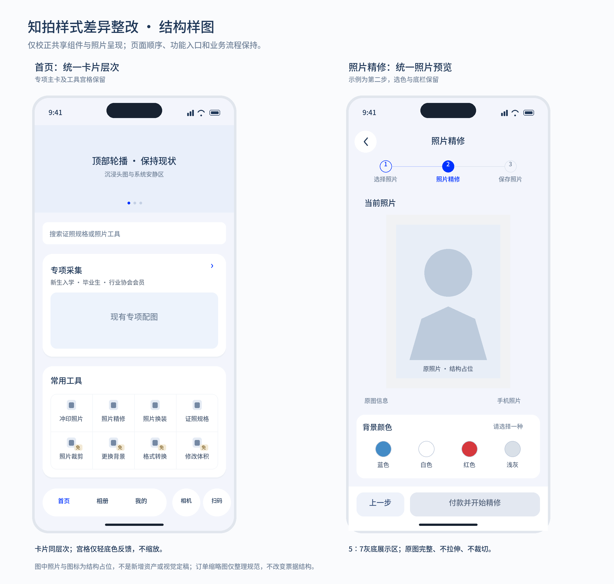

# 照片预览统一 · 第1项实施与验收

日期：2026-10-22。状态：已按用户确认结构实施，待用户视觉验收。用户已要求提交并推送Git，具体版本以仓库记录为准；未部署站点。随后确认的「换装仅知拍相册」本次仅同步文档，功能代码仍待实施。

## 已确认范围

仅整改照片预览，视觉沿用知拍现有规范与Impeccable的Operate原则：完整照片、稳定比例、克制分层。下图为用户已确认的结构样图；本轮仅实施右侧照片预览相关部分，左侧首页卡片与宫格属于后续第2项，未修改。

## 原因与改动

- `tools.css`中的精修／换装选择器优先级高于后加载的公共规则，仍可能保留照片外层阴影及预览区的满宽、310px／280px高度上限、圆角和底色。此前文档笼统判断「后加载即无阴影」不准确，本轮已更正。
- 移除上述冲突；普通工具工作展示框由`photo-previews.css`统一控制，5∶7、最大250px宽、浅灰留白、无边框／圆角／阴影。空间不足时随可用宽度等比缩小，正文滚动，不压缩或遮挡固定操作区。
- 去除照片外层原白卡遗留的上下内距，保留水平信息对齐与组间距，避免照片变高后再叠加空卡片留白；白色参数设置卡的内距保持。
- 选图与工作预览的直接图片在已确定的展示框内完整等比居中，不让原始横竖比例参与外框高度。灰底仅标识展示范围，不写入原图或输出文件。
- 精修前后标签仍在照片下方，左右边缘跟随工作预览；完成页236px上限及其对比标签保持。
- 设置卡的白底16px圆角、背景选择、导航、按钮、处理动效与业务状态逻辑保持。未改变实际裁剪、冲印排版、付款小图、个人制作或专项预览尺寸。

## 前后流程核对

| 阶段 | 本轮要求 | 检查边界 |
| --- | --- | --- |
| 选图／检查 | 250px上限、5∶7、原照片完整；换图和检查恢复仍在原位置 | 选图CSS与既有工具状态检查 |
| 第二步／处理中 | 保持原图或实际结果来源、设置卡和固定底栏；扫描范围仍为实际图片内容 | CSS归属、照片边界计算与监听生命周期检查 |
| 失败／保存重试 | 保留原图、原参数、已付原单；不重复收费或生成相册记录 | 既有六工具流程回放 |
| 完成 | 沿用236px完成预览、目的地与再处理入口 | 未修改ToolResult组件、完成CSS与保存逻辑 |

## 验证记录

已完成以下检查：

- `node --test --test-reporter=spec tests/photo-processing.test.mjs tests/photo-processing-lifecycle.test.mjs tests/bindings.test.mjs`：13项通过，覆盖横图／方图／窄竖图的contain留白、预览缩放、图片替换、测量与监听清理，以及初始数据绑定。
- `node scripts/test-flows.mjs tools-flow.cjs`：通过，覆盖七工具选图与检查、付款前置、重复付款／保存保护、原单恢复、四项免费工具下载及付费／免费共用完成页。
- PostCSS解析35个样式文件；对比整改前`d37381b`基线，照片卡与工作展示框原有14处冲突声明已清除，未遗留满宽、独立高度上限、旧圆角、底色或阴影覆盖。设置卡白底16px圆角、完成预览236px及业务JS文件保持。
- 展示框数值核对：内容区可用334px或252px时为250×350px，可用180px时为180×252px，均为5∶7。这是源码与数值检查，不是实际浏览器布局测量。
- 根设计规范、Impeccable JSON与10个组件示例校验通过；23个旧章节锚点与原156行非空正文仍保留。结构文档内脚本解析、模块相关161处本地文件链接与差异空白检查通过。
- `npm run build`：通过，147个模块。仍有既有jsQR非module脚本及大于500kB产物提示，与本次CSS整改无关，本轮未扩展处理。

本轮未自动操作浏览器、截图或运行自动UI测试。源码、数值及模拟状态检查不代表实际页面或三端真机验收，待用户按下方清单验收。

## 用户验收

1. 精修、换装各选一张照片，检查从选图进入第二步后照片比例、底色、边缘与居中是否一致；横图／方图／长竖图均应完整、不拉伸、不裁切。
2. 精修第二步背景色初始不选；选后仍显示原图，主按钮按既有条件启用。换装服装卡、参数及付款入口保持。
3. 处理中扫描只覆盖实际照片，失败和保存重试仍保留原输入及已付记录；前后标签位于照片下方、左右对齐。
4. 通过界面自然滚动查看长内容，底部操作区保持可达；完成页仍使用既有布局，再处理从选图开始。

未自动操作浏览器、截图或运行自动UI测试；实际视觉、触摸和三端效果由用户验收。本项验收前不推进第2、3项。
